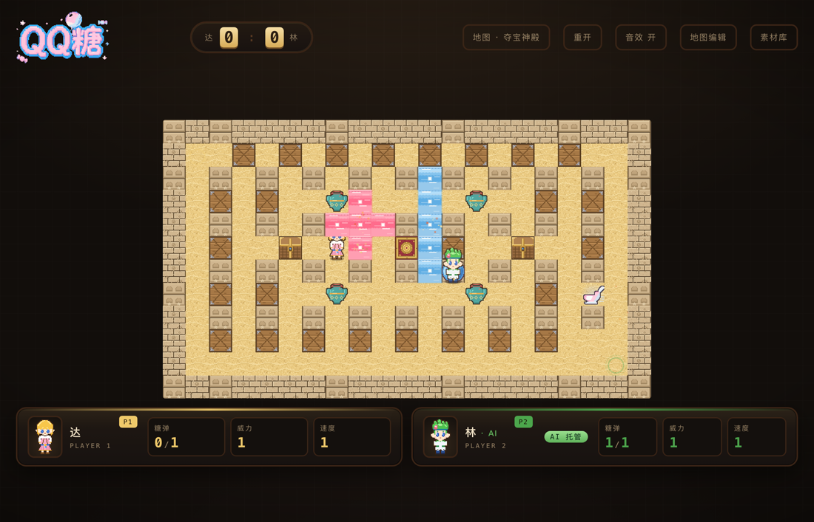
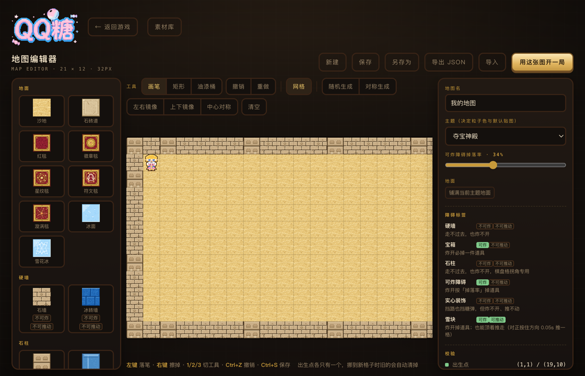
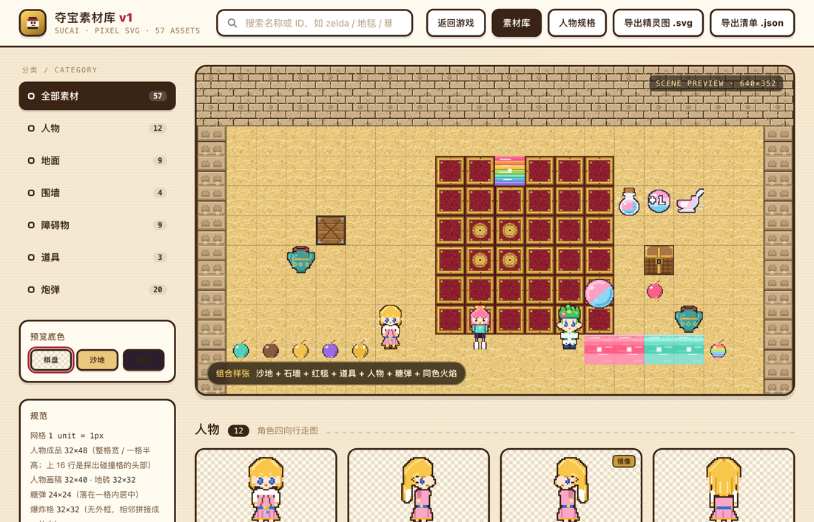

# 夺宝对决 · QQTang

浏览器里双人对战的炸弹人小游戏 **＋ 局内地图编辑器**：自己画地图，10 秒开一局。

🎮 **在线直接玩** → https://chitandaaaaa.github.io/QQTang/
🗺️ 素材库 → https://chitandaaaaa.github.io/QQTang/v2/gallery.html



## 玩法

| | 移动 | 放糖弹 |
|---|---|---|
| **P1 · 达** | `W` `A` `S` `D` | `空格` |
| **P2 · 林** | `↑` `←` `↓` `→` | `回车` |

炸开木箱吃道具（威力 / 糖弹数 / 速度），把对手困在火焰里即胜，先赢 3 局夺冠。
单人游玩时 P2 可以切「AI 托管」，它会自动走位、躲火、拆箱、放弹。

## 特色

**① 局内地图编辑器（21 × 12）**
画笔 / 矩形 / 油漆桶三种工具，撤销重做、网格吸附，左右镜像 / 上下镜像 / 中心对称一键生成，
随机生成一张图只需要点一下。存好的图存在本机浏览器里，点「用这张图开一局」直接进对局——
不用导出文件、不用跳转页面。



**② 两套主题**
夺宝神殿 / 冰原，地面、砖块、可炸障碍、火焰粒子整套切换，编辑器里还能调「可炸障碍掉落率」。

**③ 素材库**
57 件素材全为自绘 SVG：人物四向点阵（32×48）、炮弹 24×24、爆炸格 32×32、地形砖块 32×32。
素材库页面可以翻分类、看组合样张、导出精灵图。



**④ 无打包的纯静态实现**
Canvas 渲染，逻辑按职责拆成 22 个模块；配套 Python 素材生成管线与 5 套无头浏览器回归（267 条断言）。

## 目录结构

```
v2/                        页面（双击 index.html 即玩，file:// 可用）
  index.html               主页 = 游戏 + 页内编辑器模式
  gallery.html             素材库 + 人物规格（页签）
  css/  js/                样式与脚本（js/game/ 按功能切成 22 个模块）
  data/                    生成数据（勿手改）：sprites / maps / tags / gallery-data / spec-data
  assets/                  生成资源（logo）
tools/
  build_v2.py              数据管线：生成 v2/data/*.js、v2/assets/logo.svg、assets/sucai/*.svg
  asset_db.py              素材总表（分类 / 来源 / 组合样张）
  spec_db.py               人物规格数据（糖豆 / 青羽 / 夜蔷薇 / 银霜）
  sucai_*.py               像素素材定义（人物 / 地图 / 炮弹 / 特效 / 道具）
  build_assets.py          糖豆点阵 + 调色板 + to_svg
  build_chars.py           青羽 / 夜蔷薇 / 银霜点阵
  obstacle_tags.py         障碍标签表（编辑器与素材库共用）
  sucai_logo.py            logo 生成（改 logo 后单独跑）
  maps/                    内置地图 JSON（丢一张进来重跑 build_v2 即可加图）
  tests/ + run_test.py     五套无头浏览器回归（267 条断言）
assets/sucai/              生成的 SVG 素材 —— 美术真源
sucai/                     原始参考图（仅本地，不入库）
```

## 常用命令

```
python tools/build_v2.py      改了素材定义 / 地图 / logo 后重新生成数据
python tools/run_test.py      全量回归（游戏 / 编辑器 / 集成 / AI / 素材库）
python tools/sucai_logo.py    只重新生成 logo
```

无头浏览器路径默认取本机 Chrome / Edge，可用环境变量 `QQTANG_EDGE_PATH` 覆盖。

## 工作流约定

- **改游戏 / 编辑器代码**：直接改 `v2/js/game/*.js`、`v2/js/editor.js`、css、html，浏览器刷新即生效，无需构建。
- **别改 `v2/data/*`**：全是生成物。
- **改素材**：`assets/sucai/*.svg` 是真源，管线**不覆盖已存在的文件**（手调的满格炮弹等都以文件为准）；
  新增素材在 `tools/sucai_*.py` 里定义后跑 `build_v2.py` 生成初稿，之后直接改 SVG 文件精修。
- **加地图**：JSON 丢进 `tools/maps/`，重跑 `build_v2.py`；字段规范见 `tools/maps/README.md`。
- 游戏逻辑原本是单文件 `main.js`，现按原分段切成 `js/game/01-const.js … 22-boot.js`，
  加载顺序即原语句顺序，各文件共享全局作用域（勿包裹 IIFE）。
- 编辑器（`js/editor.js`）是 IIFE 隔离的页内模式；测试钩子 `window.__game` / `window.__editor`，
  断言在 `tools/tests/*.js`，跑法见 `tools/run_test.py`。
- 「用这张图开一局」= 编辑器存图 → `__game.addMap()` → 页内切回游戏模式（不再导出单文件网页）。

## 在线托管（GitHub Pages）

仓库公开托管于 `Chitandaaaaa/QQTang`，推 main 即发布。根目录 `index.html`
只是个跳板，立即重定向到 `v2/index.html`（主页即游戏）；素材库在 `v2/gallery.html`。`sucai/` 参考图不入库。

## License

MIT
